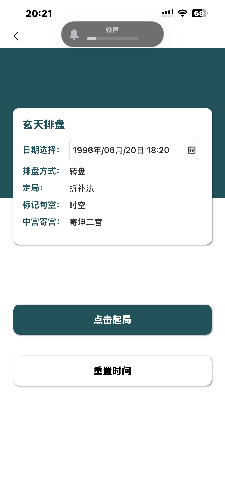
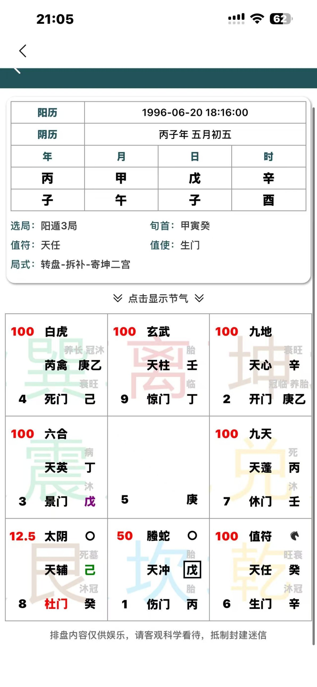

# 奇门遁甲排盘 App — Build Spec

Exported from the spec doc on 2026-11-04. This file is the copy Claude Code builds against; keep it current when the spec changes.

## 1 · Overview & scope

The app reproduces 玄天排盘's hour chart (时家奇门) exactly — 转盘, 拆补法, 时空 marking, 中五寄坤二宫 — in 简体中文 only (§4).

| Area | What ships in v1 |
| --- | --- |
| Input screen | Date-time picker (defaults to now), four fixed setting rows, 点击起局, 重置时间 |
| Chart screen | Header card (阳历, 阴历, 四柱, 选局, 旬首, 值符, 值使, 局式), collapsible 节气 panel, 3×3 palace grid with every color and marker, disclaimer footer |
| Offline | Installs to the iPhone home screen and opens with no network (§11) |

Out of scope for v1: 飞盘, 置闰 or 茅山 定局, 真太阳时 or a time-zone input, 日空 marking, other 寄宫 rules, saved charts, interpretation text and a second language. The engine still takes each fixed setting as a parameter, so any of these can be added later without rework.

## 2 · Screens

Two screens, mobile-first (designed at 390 px wide), copying 玄天排盘's layout; the screenshots below are the visual reference.

### Input screen



| Element | Behavior |
| --- | --- |
| Title | The app's name, 奇门排盘 (玄天排盘 is the reference app's name) |
| 日期选择 | Date-time picker, minute precision, shown as `1996年/06月/20日 18:20`; opens at the current time and keeps up with the clock until changed; range 1900–2100; on screens narrower than 390 px the text shrinks to fit |
| 排盘方式 · 定局 · 标记旬空 · 中宫寄宫 | Read-only rows: 转盘 · 拆补法 · 时空 · 寄坤二宫 |
| 点击起局 | Primary button (teal fill, white text): casts the chart and opens the chart screen |
| 重置时间 | Secondary button (white, black text): resets the picker to now |

### Chart screen



- Back arrow returns to the input screen with the entered time kept, as does the browser's or system's back. Forward, or a reload on the chart screen, shows the chart again.
- Header card: a bordered table with rows 阳历 (`YYYY-MM-DD HH:mm:ss`, seconds always 00) and 阴历 (`丙子年 五月初五`), then a 4-column 年 / 月 / 日 / 时 table (stems row, branches row). Under it, label–value pairs in two columns: 选局 · 旬首, 值符 · 值使, then 局式 `转盘-拆补-寄坤二宫` on its own line.
- `⌄ 点击显示节气 ⌄` toggles a 节气 panel, collapsed by default: current 节气 and its start time, next 节气 and its start time, 元 and 符头 (inferred, see Q8).
- 3×3 grid, south up: 巽4 离9 坤2 / 震3 中5 兑7 / 艮8 坎1 乾6.
- Footer, centered gray: 排盘内容仅供娱乐，请客观科学看待，抵制封建迷信.

### Palace cell

Each outer palace is a 5-row × 3-column layout:

| Row | Left | Middle | Right |
| --- | --- | --- | --- |
| 1 | Score (red, bold) | 八神 | Markers: ○ then ♞ |
| 2 |  |  | 天盘 长生 labels (small, light gray) |
| 3 |  | 九星 | 天盘 stem(s) |
| 4 |  |  | 地盘 长生 labels (small, light gray) |
| 5 | Palace number | 八门 | 地盘 stem(s) |

- Behind the text sits the palace's trigram character (巽 离 坤 震 兑 艮 坎 乾), about 70% of the cell height, in a pale 五行 tint (§3).
- Two-stem slots: wherever 天芮 lands, the star reads 芮禽 and the 天盘 shows two stems; 坤2's 地盘 always shows two. In both, the 中5 stem comes first (R1: 巽4 天盘 庚乙, 坤2 地盘 庚乙). Their 长生 labels are two groups split by a space, in the same order.
- 中5 shows only the number 5 (bottom-left) and its 地盘 stem (bottom-right): no score, deity, star, door, labels or watermark.

## 3 · Colors & markers

Every color and marker follows a fixed rule, and each rule below matches all six reference charts.

| Element | Looks like | Shown when | Applies to |
| --- | --- | --- | --- |
| Score | Red bold number, top-left: 100, 50, 25, 12.5 (6.25 possible) | Always, outer palaces | §5 step 12 |
| 门迫 | Door name in red | The door's element overcomes the palace's element | Door |
| 击刑 | Stem in purple | 戊 in 震3, 己 in 坤2, 庚 in 艮8, 辛 in 离9, 壬 or 癸 in 巽4 | Every displayed stem, 天盘 and 地盘, incl. the lodged 中5 stem in 坤2 |
| 入墓 | Stem in green | 乙 丙 戊 in 乾6, 丁 己 庚 in 艮8, 辛 壬 in 巽4, 癸 in 坤2 | Every displayed stem |
| 日干 (本人) | Black square border around the stem | 天盘 stem equals the day stem; none when the day stem is 甲 (R5, R6) | 天盘 only |
| 空亡 | ○ right of the deity | Palace holds one of the hour's two 旬空 branches | Palace |
| 马星 | ♞ black horse, after any ○ | Palace holds the hour's 驿马 branch | Palace |
| 十二长生 | Small light-gray characters above each stem row | Always | Each displayed stem |
| Trigram watermark | Large pale character behind the cell | Always | Tinted by the palace's element |

A square combines with a color (R2 艮8 and R3 乾6 show a green stem inside a square). A stem that is both 击刑 and 入墓 (庚 in 艮8, 壬 in 巽4) never appears in the screenshots; default to purple until Q6 is checked.

Colors sampled from the screenshots; red, purple and green look like the CSS named colors:

| Token | Hex | Used for |
| --- | --- | --- |
| teal | #22535A | Header band, primary button, field labels |
| red | #FF0000 (sampled #F50505) | Score, 门迫 door |
| purple | #800080 (sampled #7C067A) | 击刑 stem |
| green | #008000 (sampled #0A7A0D) | 入墓 stem |
| label-gray | #C8C8C8 | 十二长生 labels |
| footer-gray | #666666 | Disclaimer |
| wood | #D9F2E5 | 巽4, 震3 watermark |
| fire | #F3D6D7 | 离9 watermark |
| earth | #E9E0D8 | 坤2, 艮8 watermark |
| metal | #FEF5D9 | 兑7, 乾6 watermark |
| water | #D8F2FA | 坎1 watermark |

## 4 · Language

The app is in 简体中文 only, like 玄天排盘. The first build also had an English mode behind a 中 | EN toggle; it was removed in November 2026 to keep the app simple.

- Every label is the 中文 text §2 shows, written in the UI where it appears. There is no string table.
- The engine's values are the Chinese terms the chart shows (§7), and the UI prints them as they are. The one exception is 腾蛇, which 玄天排盘 prints as 螣蛇 (§6).

Text that the screenshots don't show:

| Where | Text |
| --- | --- |
| Chart screen heading, for screen readers only | 排盘结果 |
| Back arrow's label, for screen readers only | 返回 |
| 节气 toggle while the panel is open | 点击隐藏节气 |
| 节气 panel labels | 当前节气 · 下一节气 · 元 · 符头 |

## 5 · Calculation engine

`castChart(input)` is a pure function, and these 12 steps reproduce every visible field of the six reference charts — 474 of 474, checked with a reference implementation. Steps 1–3 come from the calendar library; steps 4–12 are lookups in the §6 tables and should be hard-coded.

1. **Time basis.** Read the entered wall-clock time as Beijing time (UTC+8): no time-zone conversion, no DST removal, no 真太阳时 (Q4, Q5). Minute precision.
2. **Calendar.** 年柱 switches at the exact 立春 instant and 月柱 at the exact instant of each 节. 日柱 switches at 23:00, so 23:00–23:59 belongs to the next day (Q1). 时柱 uses 2-hour branches starting 23:00 (子), its stem by 五鼠遁 from that day's stem. 阴历 = the lunar year's 干支 (from 正月初一) + lunar month (闰 prefix when leap) + lunar day. In lunar-typescript: `getYearInGanZhiExact`, `getMonthInGanZhiExact`, `getDayInGanZhiExact`, `getTimeInGanZhi`, and `getYearInGanZhi` + `getMonthInChinese` + `getDayInChinese`.
3. **节气, 符头, 元.** 节气 = the latest of the 24 terms at or before the instant (`getPrevJieQi(false)`). 符头 = the latest 甲 or 己 day on or before the 日柱 (its 60-cycle index minus its stem index mod 5). 元 from the 符头's branch: 子午卯酉 上元, 寅申巳亥 中元, 辰戌丑未 下元.
4. **局 (拆补法).** Look up 阴/阳 and the number in the 局 table (§6) by 节气 and 元: 冬至 through 芒种 are 阳遁, 夏至 through 大雪 are 阴遁.
5. **地盘.** Lay 戊 己 庚 辛 壬 癸 丁 丙 乙 one per palace, starting at the palace numbered by the 局 and moving through 1–9 including 5: ascending in 阳遁, descending in 阴遁, wrapping between 9 and 1. The 中5 stem is also shown in 坤2, in front of 坤2's own stem.
6. **旬首, 值符, 值使.** The 时柱's 旬 gives the hidden 甲's 仪: 甲子 戊, 甲戌 己, 甲申 庚, 甲午 辛, 甲辰 壬, 甲寅 癸 (shown as 旬首 `甲寅癸`). P0 = that 仪's 地盘 palace; 值符 = P0's home star and 值使 = P0's home door. If P0 = 5, 值符 = 天禽 (shown 芮禽), 值使 = 死门, and both rotate from 坤2.
7. **天盘 (转盘).** Target T = the 地盘 palace of the hour stem (a 甲 hour uses the 旬首's 仪; T = 5 becomes 坤2). Rotate the eight outer stars as a rigid ring along 1→8→3→4→9→2→7→6 (clockwise) so the 值符's home lands on T — the same in 阴遁 and 阳遁. 天禽 always travels with 天芮 (label 芮禽). Each star carries its home palace's 地盘 stem; 芮禽 carries two, 中5's then 坤2's.
8. **八门.** k = the 时柱's position in its 旬 (甲 = 0 … 癸 = 9). From P0 — the actual palace, 5 allowed — walk k steps through 1–9 including 5: +1 per step in 阳遁, −1 in 阴遁, wrapping. Landing on 5 means 坤2. Rotate the eight doors as a rigid ring along the same clockwise order so the 值使 lands there.
9. **八神.** Order: 值符 腾蛇 太阴 六合 白虎 玄武 九地 九天. 值符 sits on T; the rest follow the ring clockwise in 阳遁 and counterclockwise in 阴遁.
10. **空亡 and 马星.** 时空: the two branches the hour's 旬 skips (§6) put ○ on the palaces holding them. 时马 from the hour branch — 申子辰 → 寅, 寅午戌 → 申, 巳酉丑 → 亥, 亥卯未 → 巳 — puts ♞ on that branch's palace.
11. **Stem and door flags.** 击刑 and 入墓 per stem from §6, judged in the palace where the stem is displayed (the lodged 中5 stem counts as 坤2). 日干: a 天盘 stem equal to the day stem, never on a 甲 day. 十二长生: each displayed stem's stage at each of the palace's branches, in the order §6 lists them. 门迫: the door's element overcomes the palace's (木克土, 土克水, 水克火, 火克金, 金克木).
12. **Score.** Score = 100 ÷ 2ⁿ, where n = 1 if the palace is 空亡, +1 if 门迫, +1 for each 击刑 and each 入墓 among its 天盘 stems. 地盘 flags, 马星 and 日干 don't count. Print without trailing zeros (12.5, 6.25).

Worked check, R1 艮8 = 12.5: ○ (丑 is void) + 杜门 (wood) in 艮 (earth) + 天盘 己 入墓 gives n = 3.

## 6 · Reference tables

Every constant the engine needs. The English names are glosses for readers of this spec; the app doesn't show them.

**Palaces**, in ring order (clockwise), the order every rotation follows. Corner branches are listed left to right as they sit on the grid, which is also the order of the 长生 labels.

| Palace | English | Element | Branches | Home star | Home door | Watermark |
| --- | --- | --- | --- | --- | --- | --- |
| 坎1 | Kan ☵ | 水 water | 子 | 天蓬 | 休门 | water |
| 艮8 | Gen ☶ | 土 earth | 寅 丑 | 天任 | 生门 | earth |
| 震3 | Zhen ☳ | 木 wood | 卯 | 天冲 | 伤门 | wood |
| 巽4 | Xun ☴ | 木 wood | 辰 巳 | 天辅 | 杜门 | wood |
| 离9 | Li ☲ | 火 fire | 午 | 天英 | 景门 | fire |
| 坤2 | Kun ☷ | 土 earth | 未 申 | 天芮 | 死门 | earth |
| 兑7 | Dui ☱ | 金 metal | 酉 | 天柱 | 惊门 | metal |
| 乾6 | Qian ☰ | 金 metal | 亥 戌 | 天心 | 开门 | metal |
| 中5 | Center | 土 earth | — | 天禽 | (死门, via 坤2) | none |

**局 table (拆补法)**, by 节气 and 元:

| 阳遁 节气 | 上 | 中 | 下 | 阴遁 节气 | 上 | 中 | 下 |
| --- | --- | --- | --- | --- | --- | --- | --- |
| 冬至 Winter Solstice | 1 | 7 | 4 | 夏至 Summer Solstice | 9 | 3 | 6 |
| 小寒 Minor Cold | 2 | 8 | 5 | 小暑 Minor Heat | 8 | 2 | 5 |
| 大寒 Major Cold | 3 | 9 | 6 | 大暑 Major Heat | 7 | 1 | 4 |
| 立春 Start of Spring | 8 | 5 | 2 | 立秋 Start of Autumn | 2 | 5 | 8 |
| 雨水 Rain Water | 9 | 6 | 3 | 处暑 End of Heat | 1 | 4 | 7 |
| 惊蛰 Awakening of Insects | 1 | 7 | 4 | 白露 White Dew | 9 | 3 | 6 |
| 春分 Spring Equinox | 3 | 9 | 6 | 秋分 Autumn Equinox | 7 | 1 | 4 |
| 清明 Pure Brightness | 4 | 1 | 7 | 寒露 Cold Dew | 6 | 9 | 3 |
| 谷雨 Grain Rain | 5 | 2 | 8 | 霜降 Frost's Descent | 5 | 8 | 2 |
| 立夏 Start of Summer | 4 | 1 | 7 | 立冬 Start of Winter | 6 | 9 | 3 |
| 小满 Grain Buds | 5 | 2 | 8 | 小雪 Minor Snow | 5 | 8 | 2 |
| 芒种 Grain in Ear | 6 | 3 | 9 | 大雪 Major Snow | 4 | 7 | 1 |

**Stems.** A stem's stage at a branch: count from its 长生 branch to that branch — forward through 子丑寅… for yang stems, backward for yin — and index the stage list below. 戊 follows 丙 and 己 follows 丁.

| Stem | English | 击刑 in | 入墓 in | 长生 at | Direction |
| --- | --- | --- | --- | --- | --- |
| 甲 | Jia | — | — | 亥 | forward |
| 乙 | Yi | — | 乾6 | 午 | backward |
| 丙 | Bing | — | 乾6 | 寅 | forward |
| 丁 | Ding | — | 艮8 | 酉 | backward |
| 戊 | Wu | 震3 | 乾6 | 寅 | forward |
| 己 | Ji | 坤2 | 艮8 | 酉 | backward |
| 庚 | Geng | 艮8 | 艮8 | 巳 | forward |
| 辛 | Xin | 离9 | 巽4 | 子 | backward |
| 壬 | Ren | 巽4 | 巽4 | 申 | forward |
| 癸 | Gui | 巽4 | 坤2 | 卯 | backward |

Branches: 子 Zi · 丑 Chou · 寅 Yin · 卯 Mao · 辰 Chen · 巳 Si · 午 Wu · 未 Wei · 申 Shen · 酉 You · 戌 Xu · 亥 Hai.

**十二长生 stages**, in order:

| # | Stage | Label | English |
| --- | --- | --- | --- |
| 0 | 长生 | 长 | Birth |
| 1 | 沐浴 | 沐 | Bath |
| 2 | 冠带 | 冠 | Youth |
| 3 | 临官 | 临 | Office |
| 4 | 帝旺 | 旺 | Peak |
| 5 | 衰 | 衰 | Decline |
| 6 | 病 | 病 | Sickness |
| 7 | 死 | 死 | Death |
| 8 | 墓 | 墓 | Tomb |
| 9 | 绝 | 绝 | Extinction |
| 10 | 胎 | 胎 | Womb |
| 11 | 养 | 养 | Nurture |

**旬, 旬首 and 时空:**

| 旬 | 仪 | 空亡 branches | Palaces marked ○ |
| --- | --- | --- | --- |
| 甲子 | 戊 | 戌 亥 | 乾6 |
| 甲戌 | 己 | 申 酉 | 坤2, 兑7 |
| 甲申 | 庚 | 午 未 | 离9, 坤2 |
| 甲午 | 辛 | 辰 巳 | 巽4 |
| 甲辰 | 壬 | 寅 卯 | 艮8, 震3 |
| 甲寅 | 癸 | 子 丑 | 坎1, 艮8 |

**Stars, gates and deities.** Gates carry their element for 门迫.

| Kind | 中文 | English |
| --- | --- | --- |
| Star | 天蓬 | Tian Peng |
| Star | 天任 | Tian Ren |
| Star | 天冲 | Tian Chong |
| Star | 天辅 | Tian Fu |
| Star | 天英 | Tian Ying |
| Star | 天芮 / 芮禽 | Tian Rui (with Tian Qin) |
| Star | 天柱 | Tian Zhu |
| Star | 天心 | Tian Xin |
| Star | 天禽 | Tian Qin |
| Gate | 休门 (水) | Rest Gate |
| Gate | 生门 (土) | Life Gate |
| Gate | 伤门 (木) | Harm Gate |
| Gate | 杜门 (木) | Block Gate |
| Gate | 景门 (火) | Scenery Gate |
| Gate | 死门 (土) | Death Gate |
| Gate | 惊门 (金) | Shock Gate |
| Gate | 开门 (金) | Open Gate |
| Deity | 值符 | Chief Symbol |
| Deity | 腾蛇 | Serpent |
| Deity | 太阴 | Grand Yin |
| Deity | 六合 | Six Harmony |
| Deity | 白虎 | White Tiger |
| Deity | 玄武 | Black Tortoise |
| Deity | 九地 | Nine Earth |
| Deity | 九天 | Nine Heaven |

玄天排盘 prints the serpent as **螣蛇** (R1 坎1, R3 坤2). The engine and the fixtures say 腾蛇; the UI displays 螣蛇.

## 7 · Data model

The engine returns one `Chart` whose shape matches each case in `golden_charts.json`, so tests compare it directly and the UI only reads it. Values are the Chinese terms the chart shows; the UI prints them as they are (§4).

```ts
type Stem = '甲' | '乙' | '丙' | '丁' | '戊' | '己' | '庚' | '辛' | '壬' | '癸';
type PalaceNo = 1 | 2 | 3 | 4 | 6 | 7 | 8 | 9;   // outer palaces; 中5 is `center`

interface ChartInput { year: number; month: number; day: number; hour: number; minute: number } // Beijing wall clock

interface HeavenStem { stem: Stem; jiXing: boolean; ruMu: boolean; riGan: boolean }
interface EarthStem  { stem: Stem; jiXing: boolean; ruMu: boolean }

interface Palace {
  god: string;            // 值符 … 九天
  star: string;           // 天蓬 … 天心, or 芮禽
  door: string;           // 休门 … 开门
  menPo: boolean;
  heaven: HeavenStem[];   // 1 stem, or 2 where 芮禽 sits (中5 stem first)
  earth: EarthStem[];     // 1 stem, or 2 in palace 2 (中5 stem first)
  heavenStages: string[]; // one per heaven stem, e.g. ['养长', '冠沐']
  earthStages: string[];
  kongWang: boolean;      // ○
  horse: boolean;         // ♞
  score: number;          // 100, 50, 25, 12.5, 6.25
}

interface Chart {
  header: {
    solar: string;        // '1996-06-20 18:16:00'
    lunar: string;        // '丙子年 五月初五'
    pillars: { year: string; month: string; day: string; hour: string };
    ju: string;           // '阳遁3局'
    xunShou: string;      // '甲寅癸'
    zhiFu: string;        // '天任', or '芮禽'
    zhiShi: string;       // '生门'
    juShi: string;        // '转盘-拆补-寄坤二宫'
  };
  jieqi: { current: string; currentStart: string; next: string; nextStart: string;
           yuan: '上元' | '中元' | '下元'; fuTou: string };
  derived: { dun: '阳' | '阴'; juNumber: number; zhiFuPalace: number; zhiShiPalace: number;
             kongWangBranches: string[]; horseBranch: string };
  center: Stem;           // 中5 地盘 stem
  palaces: Record<PalaceNo, Palace>;
}
```

`castChart(input, settings = DEFAULTS)` takes the four fixed settings plus the two calendar conventions (子时 day change, 节气 switch) as an object, so Q1–Q3 can flip a default without touching the steps.

## 8 · Acceptance tests

`fixtures/golden_charts.json` holds 19 cases: R1–R6 are your six screenshots and must match field for field; D1–D13 are edge cases computed with the default rules, not yet confirmed in 玄天排盘.

| ID | Input (Beijing time) | What it pins down | Confirmed |
| --- | --- | --- | --- |
| R1 | 1996-06-20 18:16 | 阳遁3局 baseline; 艮8 score 12.5 from three factors | Yes |
| R2 | 1960-08-29 06:05 | 阴遁7局; 惊门 门迫 in 巽4; green stem inside a square | Yes |
| R3 | 1960-07-19 07:32 | 日干 square inside the two-stem 芮禽 slot; 坤2 score 25 | Yes |
| R4 | 1991-11-09 09:05 | Lodged 中5 stem 己 turns purple in 坤2 | Yes |
| R5 | 1998-03-18 11:30 | 甲 day, so no square; 天盘 戊 击刑 in 震3 | Yes |
| R6 | 1990-08-17 02:10 | 旬首 in 中5: 值符 芮禽, 值使 死门 | Yes |
| D1 | 2026-11-04 08:00 | 甲 hour → 伏吟, everything at home | No |
| D2 | 2026-11-04 16:00 | Hour stem in 中5 → 值符 moves to 坤2 | No |
| D3 | 2026-11-04 00:00 | 值使 count lands on 5 → stays in 坤2 | No |
| D4 | 2026-11-04 06:00 | 庚 in 艮8 is both 击刑 and 入墓: score 25 | No (Q6) |
| D5 | 2026-11-04 04:00 | 巽4 stacks four factors: score 6.25 | No (Q6) |
| D6 | 2025-08-01 12:00 | Leap month: 乙巳年 闰六月初八 | No |
| D7 | 2026-11-05 23:30 | 23:00 day change: 日柱 甲申, 阴遁8局 | No (Q1) |
| D8, D9 | 2026-11-07 16:30, 19:30 | Either side of 立冬 (17:52) | No (Q2) |
| D10, D11 | 2027-02-04 08:30, 10:30 | Either side of 立春 (09:46): 年柱 丙午 → 丁未 | No (Q3) |
| D12 | 2027-02-03 20:00 | Input read as Beijing time: 大寒, 阳遁3局 | No (Q4) |
| D13 | 1990-08-17 03:30 | No DST adjustment: 时柱 丙寅 | No (Q5) |

Tests to write:

- One parametrized test per case: `castChart(case.input)` deep-equals the case's `header`, `jieqi`, `derived`, `center` and `palaces`.
- Invariants over every hour of a year (8,760 charts): each star, door and deity appears once in the outer palaces; the 天盘 stems are a permutation of the 地盘 stems; every 甲 hour is 伏吟; scores fall in {100, 50, 25, 12.5, 6.25}. The reference implementation passes all of these for 2026.
- UI: R1–R6 render the same text as the screenshots in `docs/reference/`, and every label fits its cell at 390 px wide.

## 9 · Open questions

Nine behaviors can't be settled from the six screenshots. Enter each input in 玄天排盘: a match with the default column changes nothing; a match with the last column means flipping that setting (§7) and regenerating the D cases.

| # | Question | Enter in 玄天排盘 | Default shows | Otherwise it means |
| --- | --- | --- | --- | --- |
| Q1 | When does the day change at night? | 2026-11-05 23:30 | 日柱 甲申, 阴遁8局 | 日柱 癸未, 阴遁5局: the day changes at 00:00 |
| Q2 | Do 月柱 and 局 switch at the exact 节气 time? | 2026-11-07 16:30 (立冬 at 17:52) | 月柱 戊戌, 阴遁8局 | 月柱 己亥, 阴遁9局: they switch at midnight of the 节气 day |
| Q3 | Same at 立春, for 年柱 | 2027-02-04 08:30 (立春 at 09:46) | 丙午 · 辛丑, 阳遁9局 | 丁未 · 壬寅, 阳遁5局: midnight switch |
| Q4 | Is the input read as Beijing time? | 2027-02-03 20:00 | 年柱 丙午, 阳遁3局 | 年柱 丁未: it converts from the phone's time zone |
| Q5 | Does it remove China's 1986–1991 summer time? | 1990-08-17 03:30 | 时柱 丙寅 | 时柱 乙丑: it subtracts the DST hour |
| Q6 | Color and score for a stem that is both 击刑 and 入墓 | 2026-11-04 04:00 (壬 in 巽4) | Purple; 巽4 score 6.25 | Green, or 12.5: each stem counts once |
| Q7 | Lunar month names and year near 春节 | 2027-02-04 10:30 | 阴历 丙午年 腊月廿八 | 十二月: numeric month names; 丁未年: year by 立春 |
| Q8 | What does 点击显示节气 reveal? | Any chart, tap it | Current and next 节气 with times, 元, 符头 | Copy whatever it shows |
| Q9 | Header 值符 when the 旬首 sits in 坤2 | 2026-11-04 04:00 (same input as Q6) | 值符 天芮 (the grid shows 芮禽) | 芮禽: print 芮禽 whenever 天芮 is the 值符 |

## 10 · Build notes for Claude Code

Build a static TypeScript web app, engine first and test-driven, with `qimen-spec-kit.zip` (fixtures, screenshots, reference engine) unzipped at the repo root as the contract.

- Stack: TypeScript (strict), React, Vite, Vitest — the stack picked for the earlier qimen-kit draft. Static site, no backend, mobile-first.
- Calendar: `lunar-typescript` 1.8.6 (6tail, MIT). It returns the same 四柱, 节气 times and 阴历 as the fixture generator on all 19 cases.
- Layout:
    - `src/engine/tables.ts` — every constant in §6
    - `src/engine/calendar.ts` — wraps lunar-typescript (steps 1–3)
    - `src/engine/castChart.ts` — steps 4–12, pure
    - `src/ui/InputScreen.tsx`, `ChartScreen.tsx`, `PalaceCell.tsx`
    - `tests/golden.test.ts`, `tests/invariants.test.ts`
    - From the kit: `fixtures/golden_charts.json`, `docs/reference/` (screenshots), `tools/reference/` (Python engine)
    - `src/sw.js`, `tools/offline.ts`, `public/` — the offline copy and home-screen install (§11)
- Order: tables → calendar → `castChart` until R1–R6 pass → D1–D13 → UI checked against the screenshots → open questions as you confirm them.
- Coming from the qimen-kit draft: keep its stack and test harness, take this spec's settings as the defaults, and leave 双语 mode, 置闰/茅山 and the time-zone input out of v1.
- To regenerate fixtures after a Q answer: `pip install lunar_python==1.4.8`, flip the matching parameter in `tools/reference/engine.py`, then run `verify.py` and `gen_fixtures.py`.

## 11 · Hosting & offline

The app's user is on an iPhone in mainland China. It must open with no network, and never depend on a server staying reachable from there. There is no App Store app, WeChat mini program or ICP filing.

- Hosting: GitHub Pages. `.github/workflows/deploy.yml` runs typecheck, tests and build on every push and pull request, and publishes `main` only when they pass.
- Install: open the site in Safari, then Share → 添加到主屏幕. `public/manifest.webmanifest` and `public/apple-touch-icon.png` give it the name 奇门排盘, the nine-palace icon (drawn by `tools/make-icons.mjs`) and a full-screen window.
- Offline: the built `sw.js` (`src/sw.js` plus the file list `tools/offline.ts` writes at build time) keeps every built file on the device and answers the app's own requests from that copy, online or not.
- Updates: every build changes `sw.js`, since its version hashes every file. The phone downloads a new build in the background when it can reach the site, and switches to it on the next launch. If any file fails to download, it keeps the old copy. If the site is blocked, the installed app keeps working at its last version.
- The site needs to be reachable from mainland China only for a first install or a reinstall: a new phone, a deleted icon, or iOS clearing the copy.

## Sources

- Six 玄天排盘 screenshots and its input screen (the reference charts R1–R6)
- [lunar-typescript](https://github.com/6tail/lunar-typescript) 1.8.6 — calendar library, checked against every fixture
- [Qimen Dunjia — Wikipedia](https://en.wikipedia.org/wiki/Qimen_Dunjia) — English gate names
- [qimen-2k2 guide](https://qimen-2k2.pages.dev/en/guide/) — English deity names and terms (Xun Head, Void, Traveling Horse, Heaven/Earth Plate)
